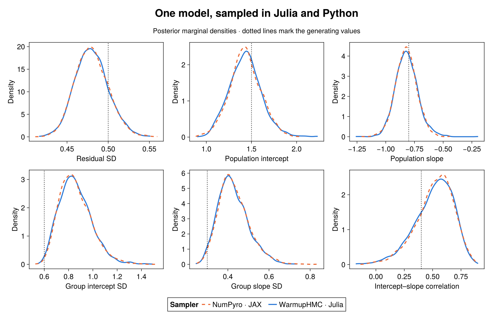
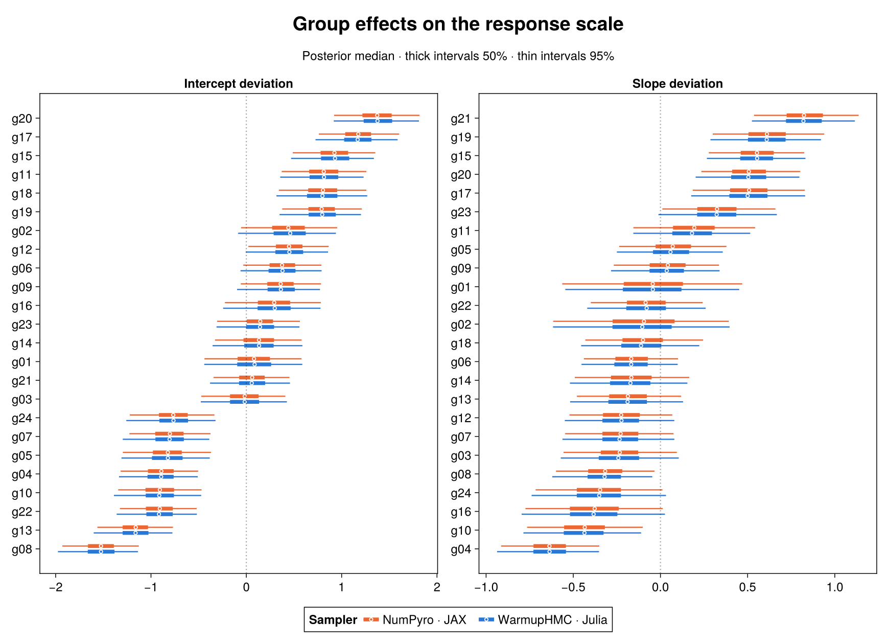

````@raw html
---
title: A Python/JAX module
description: "Export a BRM hierarchical regression to Python, sample it with NumPyro, and compare its density, gradients and posterior with native Julia."
---
````

# A Python/JAX module

`jax_source` writes a Python module from an `RKBRMI`. The module evaluates
the model's log density and constrained parameters with JAX; NumPyro or
BlackJAX can sample it without a Julia process. This example fits a
varying-intercepts, varying-slopes regression in Julia and Python, then
compares the gradients and posterior distributions.

## Model

Each group has its own intercept and slope around a population line. Their
deviations share a correlation parameter; the observation noise has one
residual standard deviation. The data are synthetic.

```@eval
mod = Main.BRMDocsComparisons.example_module(:jax)
Main.BRMDocsComparisons.evaluate_source_prelude(mod, "research/jax/reproduce.jl";
    before=:varying_slopes_model)
Base.include(mod, joinpath(Main.BRMDocsComparisons.REPOSITORY_ROOT, "research/jax/presentation.jl"))
Main.BRMDocsComparisons.comparison(mod,
    Main.BRMDocsComparisons.source_function("research/jax/reproduce.jl", :varying_slopes_model),
    :varying_slopes_model; title="Correlated group intercepts and slopes", require_stan=true)
```

```@eval
using Markdown
results = Main.BRMDocsComparisons.example_module(:jax).JAXExampleResults
run = Dict(r.key => r.value for r in results.table("run"))
Markdown.parse("The dataset has " * string(Int(run["rows"])) * " observations in " *
    string(Int(run["groups"])) * " groups. The fitted model has " *
    string(Int(run["dimension"])) * " unconstrained coordinates.")
```

## Module export

```julia
using BayesianRegressionModels, ReactiveKernels, ReactiveKernelsPPL

model = varying_slopes_model()
rk = RKBRMI(model)
source = jax_source(rk.model, rk_bound_plan(rk); values=(:mu,))
write("model.py", source)
inputs = rk_bound_data(rk)
```

The resulting [model.py](https://github.com/nsiccha/BayesianRegressionModels.jl/blob/ns/devibe/research/jax/model.py)
contains these entry points:

| Entry point | Result |
|:--|:--|
| `prepare_data(**inputs)` | Data-only calculations in NumPy, performed once per dataset |
| `log_density(u, **prepared)` | Log density in unconstrained coordinates, including the transform Jacobian |
| `log_prior(u, **prepared)` | Prior contribution |
| `log_likelihood(u, **prepared)` | Observation contribution |
| `log_jacobian(u, **prepared)` | Coordinate-transform contribution |
| `constrain(u, **prepared)` | Parameters on their declared supports, nested by model scope |
| `dimension(prepared)` | Number of unconstrained coordinates for this dataset |
| `parameters(prepared)` | Parameter names, shapes, transforms and zero-based coordinate ranges |

`values=(:mu,)` also includes the expected response in `constrain`'s output.
Request authored names such as `mu`, rather than generated implementation
variables. Parameter sizes that depend on the data are resolved by
`dimension(prepared)` and `parameters(prepared)`; `DIMENSION` and
`PARAMETERS` constants are available only for a fixed-size layout.

## Data preparation

Pass exactly the columns listed by `model.DATA`, by name. The native binding
returned by `rk_bound_data(rk)` can contain extra intermediate values; those
are not keyword arguments of `prepare_data`.

```python
import jax
jax.config.update("jax_enable_x64", True)
import jax.numpy as jnp
import model as m

# inputs: the Julia binding transferred to Python arrays and label lists
prepared = m.prepare_data(**{name: inputs[name] for name in m.DATA})
u = jnp.zeros(m.dimension(prepared), dtype=jnp.float64)
log_density = jax.jit(m.log_density)
value = log_density(u, **prepared)
gradient = jax.grad(lambda u: m.log_density(u, **prepared))(u)
expected_response = m.constrain(u, **prepared)["mu"]
```

Enable [64-bit values](https://docs.jax.dev/en/latest/default_dtypes.html)
before creating the JAX arrays to match Julia's `Float64` calculation.
`PREPARED` describes the data accepted by the density functions. JIT compilation
can reuse an executable when the new prepared inputs have the same shapes
and static shape-setting values; changing the number of groups changes the
parameter dimension.

`UNTRANSLATED` identifies data-only definitions that still need values from
Julia. Exporting those values allows Python inference to run independently;
preparing arbitrary new raw data entirely in Python requires an empty
`UNTRANSLATED` mapping.

```@eval
results = Main.BRMDocsComparisons.example_module(:jax).JAXExampleResults
run = Dict(r.key => r.value for r in results.table("run"))
results.mdtable(["Module metadata", "This example"], [
    ["DATA", string(run["data_inputs"])],
    ["PREPARED", string(run["prepared_inputs"])],
    ["UNTRANSLATED", isempty(string(run["untranslated"])) ? "None" : string(run["untranslated"])],
])
```

The reproduction script writes a JSON representation of these columns with
their types, shapes and column-major values. Its `decode` function restores
the Python inputs before calling `prepare_data`.

## Density and gradient agreement

The comparison evaluates the same unconstrained points from the native
posterior with Julia and JAX. JAX runs eagerly and under `jax.jit`; its
gradient comes from `jax.grad`, while the native gradient uses Enzyme.

```@eval
Main.BRMDocsComparisons.example_module(:jax).JAXExampleResults.parity_table()
```

These checks compare the implemented target at fixed points. Independently
sampled posterior draws need not be equal, so their comparison also reports
sampling uncertainty and convergence diagnostics.

## Posterior sampling

[NumPyro's NUTS sampler](https://num.pyro.ai/en/stable/mcmc.html#numpyro.infer.hmc.NUTS)
accepts the negative log density as its `potential_fn`. This uses the
exported density directly, including its coordinate Jacobian.

```python
import numpy as np
from numpyro.infer import MCMC, NUTS

potential = lambda u: -m.log_density(u, **prepared)
sampler = MCMC(NUTS(potential_fn=potential, target_accept_prob=0.8),
               num_warmup=1000, num_samples=1000, num_chains=4,
               chain_method="sequential", progress_bar=False)
initial = jnp.asarray(0.1 * np.random.default_rng(7).standard_normal(
    (4, m.dimension(prepared))))
sampler.run(jax.random.PRNGKey(7), init_params=initial)
draws = sampler.get_samples(group_by_chain=True)
```

The native fit uses `rk_logdensity_problem` and WarmupHMC's
`completion_warmup_mcmc`, requesting four chains with a completion quorum
of three. It runs with one Julia thread because concurrent RK/Enzyme
gradients are currently unsupported. NumPyro starts independently near zero
in unconstrained space. The two samplers have different warmup procedures;
the timings depend on those procedures and the host load. Stopping after a
quorum selects chains by completion time, which can bias a posterior if
runtime depends on the sampled region. The diagnostics below do not rule
out that selection effect.



```@eval
Main.BRMDocsComparisons.example_module(:jax).JAXExampleResults.posterior_table()
```

The correlation panel shows the intercept–slope correlation, and the group
scales are standard deviations. The last column divides the absolute
difference between posterior means by the square root of the sum of their
squared Monte Carlo standard errors. The diagnostics below summarize all
nonconstant constrained scalar parameters, including each group's
standardized effects.

```@eval
Main.BRMDocsComparisons.example_module(:jax).JAXExampleResults.diagnostics_table()
```



Each panel orders the groups by the native posterior median. These are
deviations from the population intercept or slope, after transforming the
standardized effects by their scales and correlation factor.

## New designs

Use `reprocess` to keep fitted preprocessing when changing the design:

```julia
replay = reprocess(rk, new_data)
write("replay.py", jax_source(replay.model, rk_bound_plan(replay); values=(:mu,)))
replay_inputs = rk_bound_data(replay)
```

A saved fitted state can also reconstruct a replay without the training
rows: `RKBRMI(builder(new_data), brm_fitted_state(rk))`, where `builder` is
the original data-free BRM builder. Apply the same `DATA` filter in Python.
A replay that omits a response needed by `log_density` is refused with a
`ContractValidationError`; retaining that response and requesting `values`
is different from exporting a response-free predictive program.

## Translation coverage

Successful export does not mean that every preparation step is available
in Python: check `UNTRANSLATED` as well. `JAXEmissionError` names a construct
that cannot be emitted. The current limitations include periodic HSGP
bases, the dense `gp` covariance plate, `gmrf`, and some collected plate
outputs requested through `values`. These boundaries depend on the BRM
and ReactiveKernels versions.

The package's `test/rk_jax_models.jl` exercises exported modules in a real
Python process, comparing densities, gradients, constrained values and
data-dependent dimensions. `test/rk_jax_inference.jl` adds an independent
posterior comparison. They are the executable coverage record.

## Reproduction

From the repository root, create the Python environment and run the
committed Julia driver:

```sh
python3 -m venv research/jax/.venv
research/jax/.venv/bin/python -m pip install jax==0.12.0.1 numpyro==0.22.0 numpy==2.5.4
julia --startup-file=no --project=test test/setup_env.jl
RK_JAX_PYTHON="$PWD/research/jax/.venv/bin/python" julia --startup-file=no --threads=1 --project=test research/jax/reproduce.jl
julia --project=research/adaptive_centering/plots research/jax/figures.jl
```

The plotting command uses the repository's AlgebraOfVega/CairoMakie
environment after its dependencies have been installed. The driver writes
`model.py`, encoded inputs, parity checks,
posterior summaries and plot data under `research/jax/`. The documentation
reads those committed tables; rebuilding the site does not rerun MCMC.
After a completed fit, `--reuse-draws` regenerates the summaries from the
local `native.json` and `python.json` caches. It checks that the exported
module, inputs and sampling settings match the saved run.

```@eval
Main.BRMDocsComparisons.example_module(:jax).JAXExampleResults.version_table()
```
