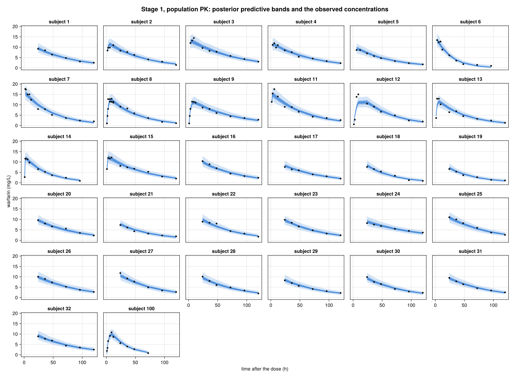
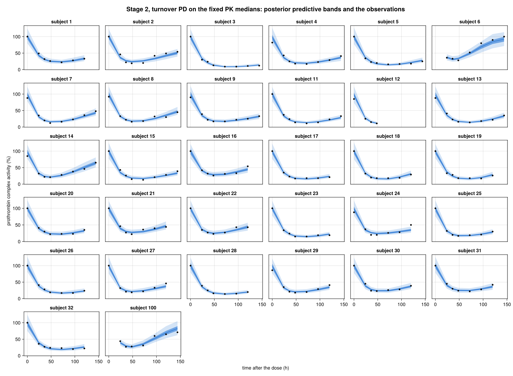
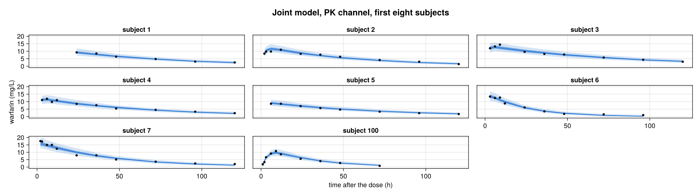
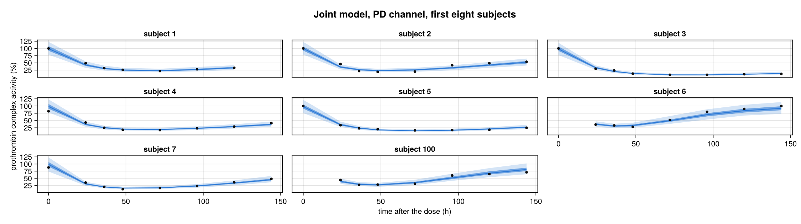
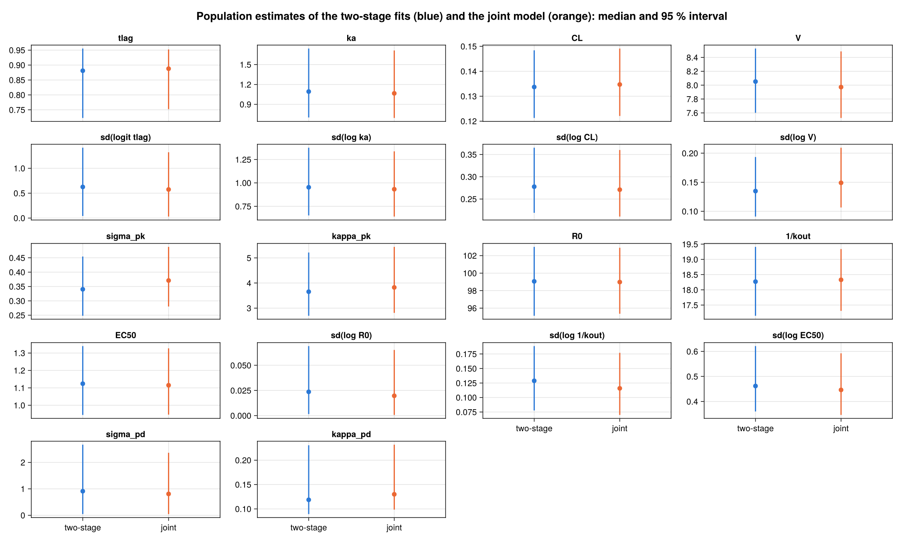

# Warfarin PK/PD

Thirty-two subjects took one oral dose of warfarin, 1.5 mg per kg of body
weight. Their plasma warfarin concentration was measured for up to 120 hours,
and their prothrombin complex activity, the anticoagulant effect in percent of
normal, for up to 144 hours. The data are O'Reilly's warfarin data as
Sebastian Weber distributed them with his StanCon 2018 example
([the file and its licence](https://github.com/nsiccha/BayesianRegressionModels.jl/tree/ns/devibe/research/warfarin/data)).

This page fits that example's models in BRM, on all 32 subjects, and shows
what they estimate:

- Weber's two-stage workflow: a population PK model, then a turnover PD model
  that takes each subject's PK posterior medians as fixed inputs;
- a joint model: one posterior, in which the PD data also inform the PK
  quantities.

Every declaration below is read from the checked-in scripts when the docs are
built, and every number and figure comes from `research/warfarin/fit.jl` and
`research/warfarin/figures.jl`.

```@eval
Main.BRMDocsComparisons.evaluate_source_prelude(
    Main.BRMDocsComparisons.example_module(:warfarin),
    "research/warfarin/reproduce.jl";
    before=:warfarin_pk_brmi,
    starting_at="StanBlocks.@deffun begin",
)
nothing
```

## The data

```@eval
using Markdown
d = Main.BRMDocsComparisons.example_module(:warfarin).warfarin_data()
Markdown.MD(Markdown.Paragraph([
    "`warfarin_data()` reads the file into one entry per subject (dose, weight) ",
    "and one vector per subject and channel (sampling times, observations): ",
    "$(length(d.subject)) subjects, $(sum(length, d.pk_dv)) concentration ",
    "measurements and $(sum(length, d.pd_dv)) activity measurements. ",
    "Five concentrations measured half an hour after the dose, all zero, are ",
    "left out, as in Weber's data preparation: the model lets the lag before ",
    "absorption be as long as one hour, so a measurement inside the lag carries ",
    "no information about the parameters.",
]))
```

## Stage 1: population PK

A one-compartment model with first-order absorption and a lag before
absorption starts. Each subject has four parameters: the lag time `tlag`, a
logistic fraction of one hour; the absorption rate `ka`; the clearance `CL`
and the volume `V`, which scale with body weight relative to 70 kg with the
allometric exponents 0.75 and 1. Each is a population value plus an
independent subject effect on the log (for the lag, the logit) scale, written
as a linear predictor with a random intercept; the weight scaling is a formula
`offset`. The plate computes the closed-form concentration course of one
subject, and observes it with Weber's `gamma2_overdisp` family, a gamma
distribution with mean `mu` and variance `sigma² + mu² / kappa`; `kappa` is
scaled by 25.

```@eval
Main.BRMDocsComparisons.comparison(
    Main.BRMDocsComparisons.example_module(:warfarin),
    Main.BRMDocsComparisons.source_function(
        "research/warfarin/reproduce.jl", :warfarin_pk_brmi,
    ),
    :warfarin_pk_brmi;
    title="Population PK",
    require_stan=true,
)
```

The population priors, the half-normal priors on the four subject SDs, the
maximal lag of one hour and the overdispersion scaling are Weber's. One
spelling differs from his Stan program: `log_inv_logit(x)` is written
`-log1pexp(-x)`, the same function.

### Estimates

Four chains of WarmupHMC's quorum sampler, 1000 draws each; the run keeps the
first three chains that finish. The table gives each population quantity on
its natural scale: posterior median, 95 % interval, split R-hat, and bulk and
tail effective sample sizes.

```@eval
Main.BRMDocsComparisons.results_table(
    "research/warfarin/results/pk/population.tsv";
    columns=[:quantity => "quantity", :unit => "unit", :description => "",
             :median => "median", :q025 => "2.5 %", :q975 => "97.5 %",
             :rhat => "R-hat", :ess_bulk => "bulk ESS", :ess_tail => "tail ESS"],
)
```

[](assets/warfarin/ppc-pk.png)

Each panel is one subject: the observed concentrations, and the median with
the 50 % and 95 % bands of the posterior predictive distribution at the
sampling times. The bands include the observation noise, so a well-fitted
subject has about half its points inside the inner band.

## The handoff

The PD stage takes, for each subject, the posterior medians of `log(tlag)`,
`log(ka)`, `log(CL)` and `log(V)` from the PK fit, with the weight effect
inside `log(CL)` and `log(V)`. They enter the PD model as the data columns
`pk_log_tlag`, `pk_log_ka`, `pk_log_cl` and `pk_log_v`
(`research/warfarin/results/pk_subject_medians.tsv`), not as parameters, so the
PD data cannot update them and the PK uncertainty does not reach the PD
predictions.

## Stage 2: turnover PD

Prothrombin complex activity `R` is produced at a constant rate `kin` and
removed at the rate `kout R`; warfarin inhibits the production:
`dR/dt = kin (1 - C / (C + EC50)) - kout R`, with `R(0) = R0 = kin / kout`,
the steady state before the dose. Each subject has `R0`, the turnover time
`1/kout` and `EC50`, each a population value with an independent subject
effect on the log scale. The plate solves the ODE for one subject with Stan's
`ode_rk45_tol` at that subject's fixed PK medians, and observes the activity
with the same gamma family, `kappa` scaled by 625.

```@eval
Main.BRMDocsComparisons.comparison(
    Main.BRMDocsComparisons.example_module(:warfarin),
    Main.BRMDocsComparisons.source_function(
        "research/warfarin/reproduce.jl", :warfarin_pd_brmi,
    ),
    :warfarin_pd_brmi;
    title="Turnover PD on fixed PK medians",
    require_stan=true,
)
```

The solver settings are Weber's: start at `t = -1e-4`, relative tolerance
`1e-5`, absolute tolerance `1e-3`, at most 500 steps.

### Estimates

```@eval
Main.BRMDocsComparisons.results_table(
    "research/warfarin/results/pd/population.tsv";
    columns=[:quantity => "quantity", :unit => "unit", :description => "",
             :median => "median", :q025 => "2.5 %", :q975 => "97.5 %",
             :rhat => "R-hat", :ess_bulk => "bulk ESS", :ess_tail => "tail ESS"],
)
```

[](assets/warfarin/ppc-pd.png)

## The joint model

The joint model declares the four PK and the three PD subject quantities
once. Both plates read the same latent PK values: the PK plate predicts the
concentrations, the PD plate solves the turnover ODE driven by them. So the
PD data update the PK quantities too, and the PK uncertainty reaches the PD
predictions. The observation families are unchanged, and the two channels
keep independent residuals: they are measured at different times, in
different units.

```@eval
Main.BRMDocsComparisons.comparison(
    Main.BRMDocsComparisons.example_module(:warfarin),
    Main.BRMDocsComparisons.source_function(
        "research/warfarin/joint_reproduce.jl", :warfarin_joint_brmi,
    ),
    :warfarin_joint_brmi;
    title="Joint PK/PD",
    require_stan=true,
)
```

### Estimates

```@eval
Main.BRMDocsComparisons.results_table(
    "research/warfarin/results/joint/population.tsv";
    columns=[:quantity => "quantity", :unit => "unit", :description => "",
             :median => "median", :q025 => "2.5 %", :q975 => "97.5 %",
             :rhat => "R-hat", :ess_bulk => "bulk ESS", :ess_tail => "tail ESS"],
)
```

[](assets/warfarin/ppc-joint-pk.png)

[](assets/warfarin/ppc-joint-pd.png)

### Two-stage against joint

[](assets/warfarin/population.png)

Each panel is one population quantity; the blue interval is the two-stage
estimate, the orange one the joint model's. The two agree on this data. The
PK quantities move by less than their interval widths: clearance at 70 kg
0.134 against 0.135 L/h, volume 8.05 against 7.97 L, absorption rate 1.09
against 1.07 per hour, lag 0.88 against 0.89 h. The PD quantities move as
little: baseline activity 99.1 against 99.0 %, turnover time 18.3 h in both,
EC50 1.12 mg/L in both, and the between-subject SDs of the log turnover time
(0.129 against 0.116) and of log EC50 (0.46 against 0.45) within a few
hundredths. What the joint model adds here is small because the PK posterior
is tight: 253 concentrations pin each subject's clearance and volume, so
fixing their medians loses little, and the PD data have little to say about
the PK quantities. The visible changes are on the noise side: the joint
model's PK noise scale is 0.37 against 0.34 mg/L and its between-subject SD
of log volume 0.149 against 0.135, since the PD channel now also weighs on
the latent PK values.

## Sampling

```@eval
Main.BRMDocsComparisons.results_tables(
    ["two-stage PK" => "research/warfarin/results/pk/fits.tsv",
     "two-stage PD" => "research/warfarin/results/pd/fits.tsv",
     "joint" => "research/warfarin/results/joint/fits.tsv"];
    columns=[:dimension => "parameters",
             :chains_requested => "chains run", :chains_kept => "chains kept",
             :omitted_chains => "omitted", :draws => "draws",
             :divergent => "divergent", :divergent_pct => "divergent %",
             :seconds => "seconds"],
    label="model",
)
```

Each fit runs its chains through `completion_warmup_mcmc`, which returns once
three of the four hold their draws; the chain still warming up is left out
and named here. Divergent transitions are counted over the retained draws:
two in the PK fit and one in the PD fit, 64 of 3000 draws (2.1 %) in the joint
model, whose 242 parameters couple each subject's seven latent quantities
through the ODE. Every R-hat in the tables above is at most 1.014 and every
bulk ESS at least 246 (the lag's between-subject SD, whose posterior reaches
down to zero). The seconds are wall-clock on four threads of the machine that
ran the fit. The fits are not part of the docs build: each ran once, into its
own directory under `research/warfarin/results/`, and the page reads the
committed tables. The receipts say what they are the numbers of.

```@eval
Main.BRMDocsComparisons.receipts_table(
    ["two-stage PK" => "research/warfarin/results/pk/receipt.tsv",
     "two-stage PD" => "research/warfarin/results/pd/receipt.tsv",
     "joint" => "research/warfarin/results/joint/receipt.tsv"],
)
```

## Provenance

Weber's StanCon 2018 contribution, [Solving ODEs in the wild: Scalable pharmacometrics with Stan](https://github.com/stan-dev/stancon_talks/tree/master/2018-helsinki/Contributed-Talks/weber/stancon18-master),
holds the data, the two Stan programs
([PK](https://github.com/stan-dev/stancon_talks/blob/master/2018-helsinki/Contributed-Talks/weber/stancon18-master/warfarin_pk_tlagMax.stan),
[PD](https://github.com/stan-dev/stancon_talks/blob/master/2018-helsinki/Contributed-Talks/weber/stancon18-master/warfarin_pd_tlagMax_2.stan))
and the R scripts. The two-stage models here follow those programs statement
by statement, on the data as his `munge.R` prepares them. His notebook prints
no estimates, so the fits above have nothing published to be compared with;
they are BRM's own. The joint model is not part of his example.

## Reproduce

From the repository root, with the test environment bootstrapped
(`julia --project=test test/setup_env.jl`):

```sh
julia -t 4 --startup-file=no --project=test research/warfarin/fit.jl
julia --startup-file=no --project=research/adaptive_centering/plots research/warfarin/figures.jl
```

The first command writes the tables under `research/warfarin/results/`, the
second the figures under `docs/src/assets/warfarin/`. The lowering and `stanc`
checks of the three declarations run without a fit:

```sh
BRM_WARFARIN_RUNTIME=0 julia --startup-file=no --project=test research/warfarin/reproduce.jl
BRM_WARFARIN_JOINT_RUNTIME=0 julia --startup-file=no --project=test research/warfarin/joint_reproduce.jl
```
